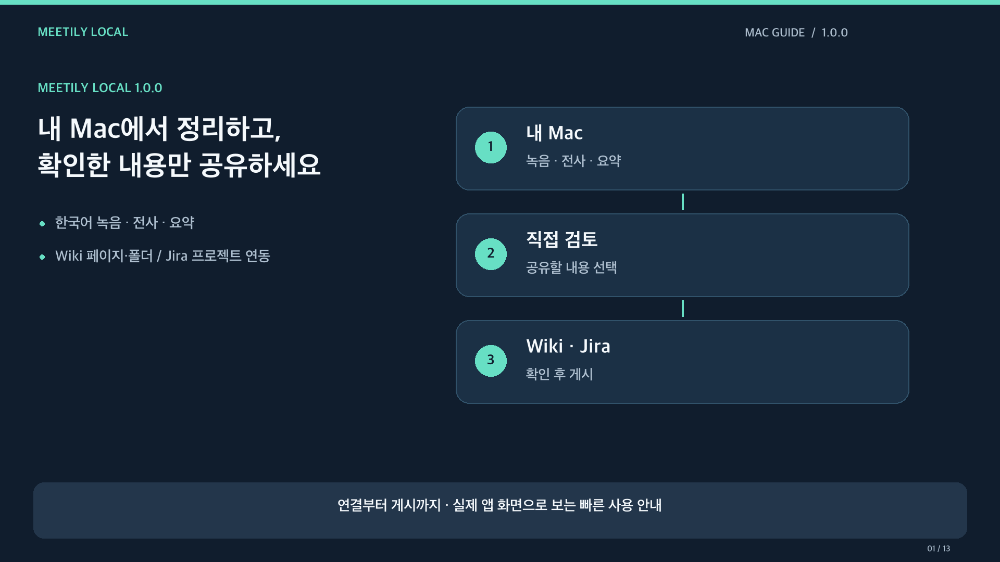

# Meetily Local video guide

The public guide covers model setup, recording/import, Wiki and Jira connection fields, summary review and explicit publication. Korean narration and on-screen instructions accompany the app screens. The detailed [Korean guide](../LOCAL-MAC.md) and [English guide](USAGE.md) remain the reference for scopes and troubleshooting.

The demonstration uses example addresses, account names and content IDs. No API token or personal account is included. Any meeting-content or saved-connection area in the images is replaced with an opaque privacy pattern. Original meeting audio is not included; narration is generated locally.

The video does not perform a real connection save or publish a page/issue. It demonstrates the controls and explains which actions make network requests. Atlassian access restrictions depend on the viewer's own account and organization.

[Watch or download the Korean video guide](https://github.com/Daewooki/meetily-local/releases/download/v1.0.0/Meetily-Local-1.0.0-public-guide.mp4) · [Download subtitles](https://github.com/Daewooki/meetily-local/releases/download/v1.0.0/Meetily-Local-1.0.0-public-guide.srt) · [Release and installer](https://github.com/Daewooki/meetily-local/releases/tag/v1.0.0)

The video includes key instructions as on-screen captions. The optional SRT contains the full narration with approximate sentence timings.
